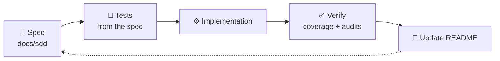
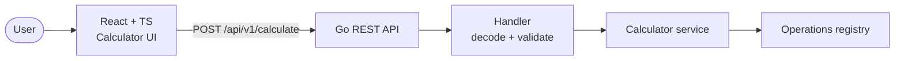
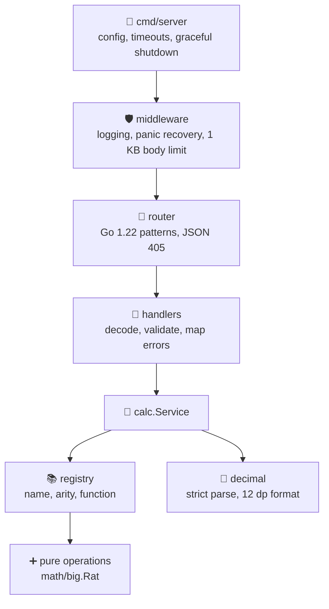
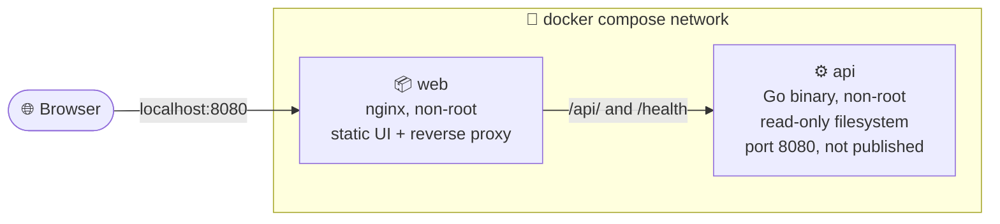
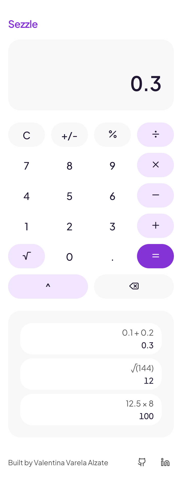
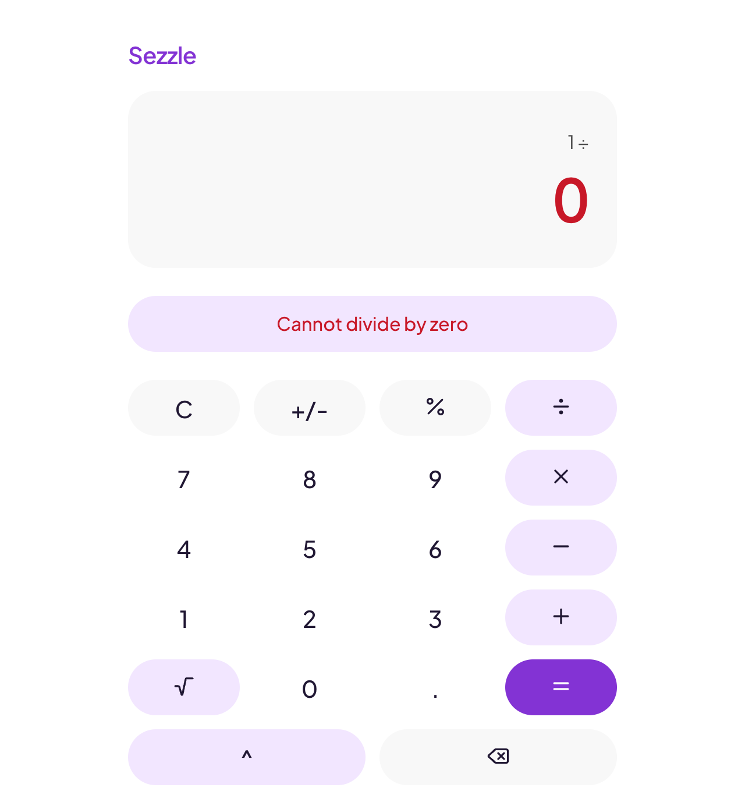

# 🟣 Calculator


**A full-stack calculator: React + TypeScript frontend, Go REST microservice.**

<!-- TODO (task D2): hero screenshot. Take it with the app running, then uncomment.
<div align="center">


</div>
-->


## 📌 Challenge summary

Build a calculator where the **React** frontend consumes a **Go** backend API for basic and advanced operations, with input validation, error handling, responsive design, unit tests, documentation and an optional Dockerfile.

Requirements

- Add, subtract, multiply, divide
- Power, square root, percent
- React UI (TypeScript), validation, errors, responsive
- Go REST API, edge cases, JSON
- Unit tests + coverage report
- Docker (frontend + backend)
- API examples, design decisions, prompts

## 🧭 How this project is built


| # | Decision | Where |
|---|---|---|
| D1 | Work with **Spec-Driven Development (SDD)**: write the spec first, then implement | [docs/sdd](docs/sdd) |
| D2 | Backend in Go using only the standard library | [00-overview](docs/sdd/00-overview.md) |
| D3 | Exact decimal math; numbers are strings in the API | [01-api-spec](docs/sdd/01-api-spec.md) |
| D4 | Operations are pure functions behind a registry | [02-backend-design](docs/sdd/02-backend-design.md) |
| D5 | Frontend with React + TypeScript + Vite | [00-overview](docs/sdd/00-overview.md) |
| D6 | UI design guided by the **taste skill** (Sezzle-inspired palette) | [prompts/01](prompts/01-taste-design-brief.md) |
| D7 | All AI prompts are versioned and shared | [prompts](prompts) |
| D8 | Docker Compose to run everything with one command | [docker-compose.yml](docker-compose.yml) |
| D9 | Specs turned into an atomic task plan, parallelizable by agents | [05-implementation-plan](docs/sdd/05-implementation-plan.md) |
| D10 | Local AI tooling (`.agents/`, `skills-lock.json`) stays out of the repo; the skill is cited here instead | [00-overview](docs/sdd/00-overview.md) |

### SDD workflow


<br>

## 🏗️ Architecture



### Backend layers

The math knows nothing about HTTP, and the HTTP layer knows nothing about math.



## 🐳 Deployment

`docker compose up` starts two containers. Only the web container publishes a port; the API is reachable **only through the nginx proxy**, which is also why the API needs no CORS headers.



| Container | Image | Notes |
|---|---|---|
| `api` | `golang` build stage, `alpine` runtime | Static binary (`CGO_ENABLED=0`), non-root user, `HEALTHCHECK` on `/health`, read-only root filesystem, all Linux capabilities dropped |
| `web` | `node` build stage, `nginx-unprivileged` runtime | Serves the built assets with an SPA fallback, proxies `/api/` and `/health` to `api`, strict `Content-Security-Policy`, starts even if `api` is down (it answers 502 until `api` is up) |

`web` waits for `api` to be healthy before starting (`depends_on: service_healthy`).

## 🧱 Backend decisions

| Decision | Why |
|---|---|
| Pure core (`internal/calc`) plus a thin HTTP layer (`internal/httpapi`) | The math is testable without HTTP, and the HTTP layer is testable with `httptest` |
| Operations live in a registry (name, arity, function) | A new operation is one function and one registry entry |
| Exact arithmetic with `math/big.Rat`, rounding only when formatting | `0.1 + 0.2` is exactly `0.3`; no float drift |
| `400` for malformed requests, `422` for valid requests that are mathematically invalid | Clients can tell "fix your request" from "that calculation has no answer" |
| The body limit reads the whole request first (1 KB) | An oversized body is always `413`, never a parse error found earlier in the stream |
| Logging is the outermost middleware | A recovered panic is still logged as a `500` |
| Unknown errors become a generic `500 INTERNAL_ERROR`; details go to the log only | No internal details leak to clients |
| Server timeouts (header 5 s, read 10 s, write 10 s, idle 60 s) and a 5 s graceful shutdown that then force-closes | A half-sent request cannot hold a connection forever, and a hung request cannot block a restart |
| Go standard library only, no third-party dependencies | Idiomatic, small, nothing to audit |
| Pinned image versions, non-root users, capabilities dropped | Reproducible builds and a smaller attack surface |

## 📚 Documentation

| Doc | Description |
|---|---|
| [00 Overview](docs/sdd/00-overview.md) | Goal, scope, decisions |
| [01 API spec](docs/sdd/01-api-spec.md) | Endpoints, payloads, error codes, examples |
| [02 Backend design](docs/sdd/02-backend-design.md) | Go layers, exact decimal rules, edge case table |
| [03 Frontend design](docs/sdd/03-frontend-design.md) | State machine, components, API client, accessibility |
| [04 Test plan](docs/sdd/04-test-plan.md) | Coverage targets, commands, acceptance scenarios |
| [05 Implementation plan](docs/sdd/05-implementation-plan.md) | Atomic tasks, dependency graph, parallel waves |
| [Design read](docs/design-read.md) | One-sentence design read, the three dials, palette and the UI audits |

## 🤖 Prompts used

The brief asks to share the prompts used. They are in [`prompts/`](prompts), organized by phase.

| # | Prompt | Phase | What it produced |
|---|---|---|---|
| 01 | [Design brief (taste skill)](prompts/01-taste-design-brief.md) | Design | Design read, three dials, audits for the UI |
| 02 | [SDD specification](prompts/02-sdd-specification.md) | Specs | `docs/sdd/00` to `04`, the ADR log, the living README |
| 03 | [Implementation plan](prompts/03-implementation-plan.md) | Planning | Atomic, parallelizable, reviewable tasks |
| 04 | [Worker agents](prompts/04-worker-agents.md) | Build | The task contract and assignment messages |
| 05 | [Reviewer and executor](prompts/05-reviewer.md) | Review | Review protocol, checklists, report format |
| 06 | [Decision prompts](prompts/06-decision-prompts.md) | Throughout | Directives that settled design and scope questions |

Start with the [prompts index](prompts/README.md) for the workflow diagram.

<!-- TODO (task D2): screenshot gallery, two columns with a bold caption, same style as job-hunter. Uncomment when the images exist.
## 📸 Screenshots

| | |
|---|---|
|  **Calculator:** a result on the display and the history below |  **Small screens:** usable at 360 px |
|  **Errors:** friendly message, for example division by zero | |
-->

## 🧮 Assumptions and known behaviors

| Topic | Behavior | Why |
|---|---|---|
| Precision | Results are rounded to **12 decimal places**, trailing zeros trimmed | Exact arithmetic (`math/big.Rat`), rounding only when formatting |
| Tiny results | A non-zero result smaller than 0.0000000000005 is shown as `0` (for example `2 ^ -100`) | Direct consequence of the 12 decimal places rule, not a calculation error |
| Exponent range | `power` accepts integer exponents from -100 to 100; anything else is `OUT_OF_RANGE` | Keeps results bounded and the service safe |
| Validation order in `power` | The exponent range is checked **before** the zero base rule, so `0 ^ -101` is `OUT_OF_RANGE` and `0 ^ -1` is `DIVISION_BY_ZERO` | One simple rule: validate the exponent first |
| Number format | Numbers travel as decimal strings, no exponent notation, up to 32 characters | Avoids float precision loss (`0.1 + 0.2 = 0.3`) |
| Percent | `percent [p, base]` means `p%` of `base` | Documented in [01-api-spec](docs/sdd/01-api-spec.md) |
| Request timeout | The UI waits at most **10 seconds** for the API, then shows "The calculator service took too long" | A hung backend must never leave the calculator stuck |
| Clear while loading | `C` stays enabled during a request and cancels it | The user can always recover |
| JSON numbers as operands | `{"operands":[1,2]}` is `400 INVALID_JSON`, not `INVALID_OPERAND` | Operands must be strings; a number is a type error in the request |
| Leading zeros and `-0` | `007` is accepted as `7`, and `-0` is returned as `0` | The grammar is `^-?\d+(\.\d+)?$`; results never show a negative zero |
| Oversized body on the wrong method | Answers `413` before `405` | The body is read before routing so the limit always applies |
| CORS | The API sends no CORS headers | The browser only talks to the proxy (Vite in dev, nginx in Docker) |

## 🚀 Setup and run

Requirements: **Go 1.22+**, **Node 20.19+** (the Docker image uses Node 22), **Docker with Compose v2**, and `make`.

### With Docker (one command)

```bash
make up        # docker compose up --build -d
```

Open <http://localhost:8080>. The API is not published; it is reachable only through the proxy, so the API calls below also go to port 8080.

```bash
make smoke     # 26 API checks against http://localhost:8080
make down      # stop and remove the containers
```

### Local development

```bash
make dev       # backend on :8080 and the Vite dev server on :5173 (proxies /api to the backend)
```

Open <http://localhost:5173>. `make dev` and `make up` both use port 8080, so run one at a time. To run the pieces separately:

```bash
make dev-api   # cd backend && go run ./cmd/server
make dev-web   # cd frontend && npm run dev
```

### Commands

| Command | What it does |
|---|---|
| `make dev` | Backend and frontend dev servers together |
| `make up` / `make down` | Start (build first) and stop the Docker stack |
| `make smoke` | Run `backend/scripts/smoke.sh` against a live stack. Override the target with `make smoke BASE_URL=http://host:8080` |
| `make test` | Backend tests with `-race` and frontend tests |
| `make coverage` | Backend and frontend coverage, HTML reports written to `docs/coverage/` |
| `make lint` | `gofmt`, `go vet` and ESLint |

Per layer: `make test-api`, `make test-web`, `make coverage-api`, `make coverage-web`, `make lint-api`, `make lint-web`.

### Configuration

| Variable | Default | Used by |
|---|---|---|
| `PORT` | `8080` | The Go API (`PORT=8081 go run ./cmd/server`) |
| `BASE_URL` | `http://localhost:8080` | `make smoke` and `backend/scripts/smoke.sh` |

## 🔌 API

Full contract: [01-api-spec](docs/sdd/01-api-spec.md). Numbers are sent and returned as **decimal strings**.

| Method | Path | Description |
|---|---|---|
| `POST` | `/api/v1/calculate` | Perform one operation |
| `GET` | `/api/v1/operations` | List the operations and their arity |
| `GET` | `/health` | Liveness probe |

Operations: `add`, `subtract`, `multiply`, `divide`, `power`, `sqrt` (one operand), `percent` (`[p, base]` is `p`% of `base`).

```bash
# Add with exact decimals
curl -s -X POST localhost:8080/api/v1/calculate \
  -H 'Content-Type: application/json' \
  -d '{"operation":"add","operands":["0.1","0.2"]}'
# {"operation":"add","operands":["0.1","0.2"],"result":"0.3"}

# 15 percent of 200
curl -s -X POST localhost:8080/api/v1/calculate \
  -H 'Content-Type: application/json' \
  -d '{"operation":"percent","operands":["15","200"]}'
# {"operation":"percent","operands":["15","200"],"result":"30"}

# Division by zero
curl -s -X POST localhost:8080/api/v1/calculate \
  -H 'Content-Type: application/json' \
  -d '{"operation":"divide","operands":["1","0"]}'
# 422 {"error":{"code":"DIVISION_BY_ZERO","message":"cannot divide by zero"}}
```

Every error uses the same envelope, `{"error":{"code","message"}}`:

| HTTP | Codes |
|---|---|
| 400 | `INVALID_JSON`, `UNKNOWN_OPERATION`, `INVALID_OPERAND_COUNT`, `INVALID_OPERAND` |
| 422 | `DIVISION_BY_ZERO`, `NEGATIVE_SQUARE_ROOT`, `NON_INTEGER_EXPONENT`, `OUT_OF_RANGE` |
| 405 | `METHOD_NOT_ALLOWED` (with an `Allow` header) |
| 413 | `PAYLOAD_TOO_LARGE` (body over 1 KB) |
| 500 | `INTERNAL_ERROR` (generic message, details only in the server log) |

## 🧪 Tests and coverage

| Layer | Tool | What it covers |
|---|---|---|
| Backend core (`internal/calc`) | `go test`, table-driven | One row per edge case in [02-backend-design](docs/sdd/02-backend-design.md): parsing, formatting, every operation, registry and service |
| Backend HTTP (`internal/httpapi`) | `go test` + `httptest` | Every status code and error code, the error envelope, 405 with `Allow`, panic recovery, the 1 KB body limit, request logging |
| Backend fuzzing | Native Go fuzzing | `ParseDecimal` and `Calculate`: no panics, valid output format, add and multiply are commutative |
| API smoke | `backend/scripts/smoke.sh` | 26 checks over HTTP: spec examples, all operations, 400, 405, 413 and 422 cases, the 1024 byte boundary |
| Frontend | Vitest + Testing Library | Reducer rules, API client, components |

| Area | Coverage | Report |
|---|---|---|
| Backend (`internal/...`) | **99.4%** | [docs/coverage/backend.html](docs/coverage/backend.html) |
| Frontend | **99.7%** (provisional, confirmed in D1) | [docs/coverage/frontend/index.html](docs/coverage/frontend/index.html) |

The backend figure covers `./internal/...`; `cmd/server` is the entrypoint wiring and is checked by the smoke test instead. Reports live at fixed paths and are overwritten by `make coverage`.

```bash
make test
make coverage
# optional: a short fuzz run
cd backend && go test ./internal/calc -run '^$' -fuzz FuzzCalculate -fuzztime 30s
```
