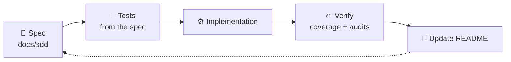

# 🟣 Calculator

**A full-stack calculator: React + TypeScript frontend, Go REST microservice.**

<!-- TODO (task D2): hero screenshot. Take it with the app running, then uncomment.

-->

## 📌 Challenge summary

Build a calculator where the **React** frontend consumes a **Go** backend API for basic and advanced operations, with input validation, error handling, responsive design, unit tests, documentation and an optional Dockerfile.

Requirements

- Add, subtract, multiply, divide
- Power, square root, percent
- React UI (TypeScript), validation, errors, responsive
- Go REST API, edge cases, JSON
- Unit tests + coverage report
- Docker (frontend + backend)
- API examples, design decisions, prompts

## 🧭 How this project is built

| # | Decision | Where |
|---|---|---|
| D1 | Work with **Spec-Driven Development (SDD)**: write the spec first, then implement | [docs/sdd](docs/sdd) |
| D2 | Backend in Go using only the standard library | [00-overview](docs/sdd/00-overview.md) |
| D3 | Exact decimal math; numbers are strings in the API | [01-api-spec](docs/sdd/01-api-spec.md) |
| D5 | Frontend with React + TypeScript + Vite | [00-overview](docs/sdd/00-overview.md) |
| D6 | UI design guided by the **taste skill** (Sezzle-inspired palette) | [prompts/01](prompts/01-taste-design-brief.md) |
| D7 | All AI prompts are versioned and shared | [prompts](prompts) |
| D8 | Docker Compose to run everything with one command | _coming soon_ |
| D9 | Specs turned into an atomic task plan, parallelizable by agents | [05-implementation-plan](docs/sdd/05-implementation-plan.md) |

### SDD workflow

 

## 🏗️ Architecture

## 📚 Documentation

| Doc | Description |
|---|---|
| [00 Overview](docs/sdd/00-overview.md) | Goal, scope, decisions |
| [01 API spec](docs/sdd/01-api-spec.md) | Endpoints, payloads, error codes, examples |
| [02 Backend design](docs/sdd/02-backend-design.md) | Go layers, exact decimal rules, edge case table |
| [03 Frontend design](docs/sdd/03-frontend-design.md) | State machine, components, API client, accessibility |
| [04 Test plan](docs/sdd/04-test-plan.md) | Coverage targets, commands, acceptance scenarios |
| [05 Implementation plan](docs/sdd/05-implementation-plan.md) | Atomic tasks, dependency graph, parallel waves |

## 🤖 Prompts used

| # | Prompt | Purpose |
|---|---|---|
| 01 | [Design brief (taste skill)](prompts/01-taste-design-brief.md) | Visual design rules for the UI |

<!-- TODO (task D2): screenshot gallery, two columns with a bold caption, same style as job-hunter. Uncomment when the images exist.
## 📸 Screenshots

| | |
|---|---|
|  **Calculator:** a result on the display and the history below |  **Small screens:** usable at 360 px |
|  **Errors:** friendly message, for example division by zero | |
-->

## 🧮 Assumptions and known behaviors

| Topic | Behavior | Why |
|---|---|---|
| Precision | Results are rounded to **12 decimal places**, trailing zeros trimmed | Exact arithmetic (`math/big.Rat`), rounding only when formatting |
| Tiny results | A non-zero result smaller than 0.0000000000005 is shown as `0` (for example `2 ^ -100`) | Direct consequence of the 12 decimal places rule, not a calculation error |
| Exponent range | `power` accepts integer exponents from -100 to 100; anything else is `OUT_OF_RANGE` | Keeps results bounded and the service safe |
| Validation order in `power` | The exponent range is checked **before** the zero base rule, so `0 ^ -101` is `OUT_OF_RANGE` and `0 ^ -1` is `DIVISION_BY_ZERO` | One simple rule: validate the exponent first |
| Number format | Numbers travel as decimal strings, no exponent notation, up to 32 characters | Avoids float precision loss (`0.1 + 0.2 = 0.3`) |
| Percent | `percent [p, base]` means `p%` of `base` | Documented in [01-api-spec](docs/sdd/01-api-spec.md) |
| Request timeout | The UI waits at most **10 seconds** for the API, then shows "The calculator service took too long" | A hung backend must never leave the calculator stuck |
| Clear while loading | `C` stays enabled during a request and cancels it | The user can always recover |

## 🚀 Setup and run

_Will be filled in when the implementation lands (backend, frontend, Docker, tests, coverage)._
