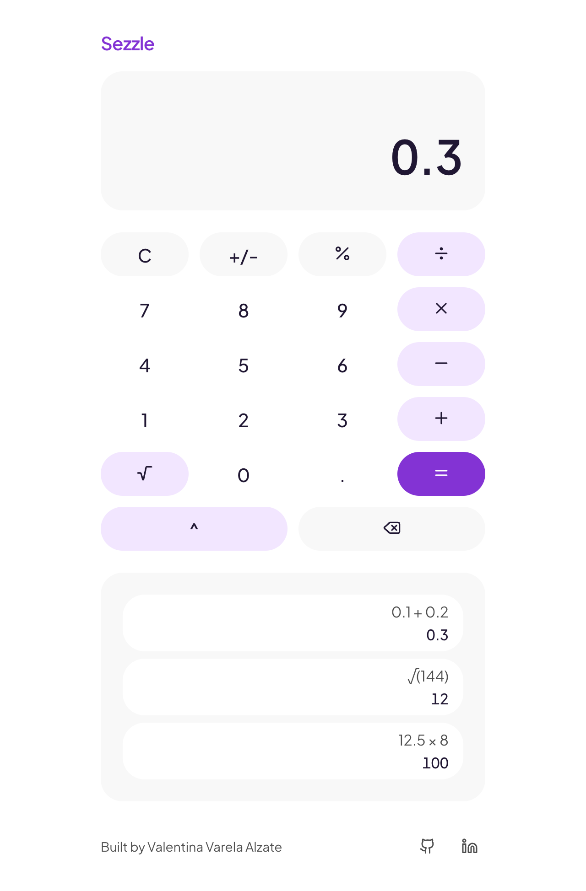
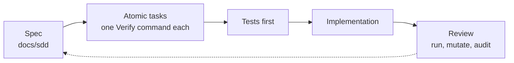
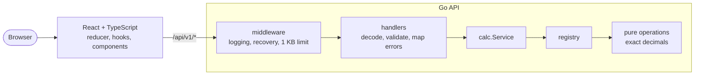

# Calculator


A full-stack calculator: a React + TypeScript frontend that calls a Go REST microservice for every operation


<div align="center">



</div>

<br>

## How it was built

The project follows **Spec-Driven Development**: the contract is written first, then the tests, then the code. Work was split into small tasks that coding agents took in parallel, and every task was reviewed against its spec before it counted.



| Document | What it settles |
|---|---|
| [00 Overview](docs/sdd/00-overview.md) | Goal, scope, decision log, checklist from the brief |
| [01 API spec](docs/sdd/01-api-spec.md) | Endpoints, payloads, error codes |
| [02 Backend design](docs/sdd/02-backend-design.md) | Layers, numeric rules, edge-case table |
| [03 Frontend design](docs/sdd/03-frontend-design.md) | State machine, components, keyboard, accessibility |
| [04 Test plan](docs/sdd/04-test-plan.md) | Coverage targets and the acceptance run |
| [05 Implementation plan](docs/sdd/05-implementation-plan.md) | The atomic task plan |
| [Design read](docs/design-read.md) | The visual direction, measured palette and audits |

## Key decisions

| Decision | Why |
|---|---|
| **Exact decimal math** (`math/big.Rat`), numbers sent as **strings** | `0.1 + 0.2` is exactly `0.3`; no float drift |
| Go with the **standard library only** | Idiomatic, small, nothing to audit |
| Operations behind a **registry** | A new operation is one function and one entry |
| `400` for malformed requests, `422` for valid but impossible ones | Clients can tell "fix the request" from "no answer exists" |
| A **pure reducer** drives the calculator | All behavior is testable without React or a network |
| UI designed with a **design-taste skill** and a palette **measured from sezzle.com**; free fonts and a text wordmark only | A consistent, brand-aware design with no licensing issues |
| `C` always works, and every request times out after **10 s** | The UI can never get stuck on a slow or dead backend |
| **Docker Compose**, with the API reachable only through the proxy | One command to run it, and no CORS needed |

## Architecture

The math knows nothing about HTTP, and the HTTP layer knows nothing about math.



## Setup and run

Requirements: **Go 1.22+**, **Node 20.19+** (the Docker image uses 22), **Docker with Compose v2** and `make`.

```bash
make up      # build and run both containers, then open http://localhost:8080
make down    # stop them
```

For development, run the backend and the Vite dev server together (open <http://localhost:5173>), or one at a time:

```bash
make dev        # backend on :8080 and frontend on :5173
make dev-api    # only the backend:  cd backend && go run ./cmd/server
make dev-web    # only the frontend: cd frontend && npm run dev
```

`make dev` and `make up` both use port 8080, so run one at a time. Set `PORT` to change the API port.

| Command | What it does |
|---|---|
| `make test` | Backend tests (with `-race`) and frontend tests |
| `make coverage` | Both coverage reports, written to `docs/coverage/` |
| `make lint` | `gofmt`, `go vet` and ESLint |
| `make smoke` | 26 API checks against a running stack (`BASE_URL` to change the target) |

## API

Numbers are sent and returned as **decimal strings**. Full contract: [01-api-spec](docs/sdd/01-api-spec.md).

| Method | Path | Description |
|---|---|---|
| `POST` | `/api/v1/calculate` | Perform one operation: `add`, `subtract`, `multiply`, `divide`, `power`, `sqrt`, `percent` |
| `GET` | `/api/v1/operations` | List the operations and their arity |
| `GET` | `/health` | Liveness probe |

```bash
# Add with exact decimals
curl -s -X POST localhost:8080/api/v1/calculate -H 'Content-Type: application/json' \
  -d '{"operation":"add","operands":["0.1","0.2"]}'
# {"operation":"add","operands":["0.1","0.2"],"result":"0.3"}

# 15 percent of 200
curl -s -X POST localhost:8080/api/v1/calculate -H 'Content-Type: application/json' \
  -d '{"operation":"percent","operands":["15","200"]}'
# {"operation":"percent","operands":["15","200"],"result":"30"}

# Division by zero
curl -s -X POST localhost:8080/api/v1/calculate -H 'Content-Type: application/json' \
  -d '{"operation":"divide","operands":["1","0"]}'
# 422 {"error":{"code":"DIVISION_BY_ZERO","message":"cannot divide by zero"}}
```

Every error uses the envelope `{"error":{"code","message"}}`: `400` for `INVALID_JSON`, `UNKNOWN_OPERATION`, `INVALID_OPERAND_COUNT` and `INVALID_OPERAND`; `422` for `DIVISION_BY_ZERO`, `NEGATIVE_SQUARE_ROOT`, `NON_INTEGER_EXPONENT` and `OUT_OF_RANGE`; `405`, `413` and `500` for the rest.

## Tests and coverage

| Area | Coverage | Report |
|---|---|---|
| Backend (`internal/...`) | **99.4%** | [backend.html](docs/coverage/backend.html) |
| Frontend (169 tests) | **99.7%** | [frontend/index.html](docs/coverage/frontend/index.html) |

- **Backend:** table-driven tests for every edge case, `httptest` for every status code, and native Go fuzzing on the parser and the service.
- **Frontend:** Vitest and Testing Library for the reducer, the API client, the components and full user flows.
- **Whole stack:** `make smoke` runs 26 HTTP checks, and the acceptance run in [04-test-plan](docs/sdd/04-test-plan.md) covers 9 scenarios in a real browser against the Docker stack.

## 🤖 Prompts used

The prompts behind the specs, the task plan, the agents and the review are in [`prompts/`](prompts), organized by phase.

## Assumptions

| Topic | Behavior |
|---|---|
| Precision | Results are rounded to **12 decimal places**, so a non-zero result below 5e-13 shows as `0` (for example `2 ^ -100`) |
| `power` | Integer exponents from -100 to 100; the range is checked first, so `0 ^ -101` is `OUT_OF_RANGE` and `0 ^ -1` is `DIVISION_BY_ZERO` |
| Number format | Decimal strings up to 32 characters, no exponent notation; `007` is accepted and `-0` returns `0` |
| `percent [p, base]` | Means `p%` of `base`; the `%` key adapts it to the usual calculator behavior |
| JSON numbers as operands | `[1, 2]` is `400 INVALID_JSON`: operands must be strings |
| Oversized body | Anything over 1 KB is `413`, even on a wrong method (the body is read before routing) |
| CORS | None needed: the browser only talks to the proxy |
