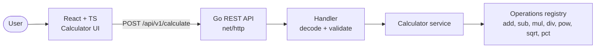

# 00. Overview

## 1. Goal

Build a full-stack calculator for the technical challenge: a **React + TypeScript** frontend that consumes a **Go REST microservice** to perform basic and advanced arithmetic.

Evaluation criteria from the HR brief: clean and idiomatic code, testable architecture, unit tests with a coverage report, documentation (setup, API usage, design rationale), optional Dockerfile.

## 2. Scope

| Area | In scope | Out of scope |
|---|---|---|
| Operations | add, subtract, multiply, divide, power, square root, percent | trigonometry, memory registers, unit conversion |
| Frontend | keypad, keyboard input, validation, error states, history, responsive (360px+) | auth, persistence of history across sessions |
| Backend | REST API, validation, edge cases, JSON errors, health check | database, auth, rate limiting |
| Quality | unit tests (both layers) + coverage report | end to end browser tests |
| Delivery | README, SDD docs, prompts log, Dockerfile + compose | CI/CD pipeline |

## 3. Key decisions (ADR log)

| # | Decision | Why |
|---|---|---|
| D1 | Work with **Spec-Driven Development**: specs in `docs/sdd/` before code | Forces clear contracts and edge cases up front, keeps the review focused on correctness |
| D2 | Backend in **Go with the standard library** (`net/http`, Go 1.22+ routing) | Idiomatic, minimal dependencies, easy to test with `httptest` |
| D3 | **Exact decimal arithmetic** with `math/big.Rat` (standard library), numbers travel as **strings** in JSON | Avoids `0.1 + 0.2 = 0.30000000000000004` and float precision loss, no extra dependency |
| D4 | Operations implemented as pure functions behind a registry | Open for extension, trivial to unit test |
| D5 | Frontend in **React + TypeScript + Vite** | Matches the brief, fast setup and test tooling (Vitest) |
| D6 | UI designed with the **taste skill** as the only source of design rules | Consistent, intentional design; Sezzle-inspired palette, text wordmark only |
| D7 | Prompts are versioned in `prompts/` and listed in the README | The brief asks to share the prompts used |
| D8 | **Docker Compose** to run frontend and backend together | Optional deliverable, one command to run everything |
| D9 | Specs become an **atomic task plan** ([05](05-implementation-plan.md)) that agents can take in parallel | Fast, reviewable delivery inside the 2 to 4 hour time box |
| D10 | `.agents/` and `skills-lock.json` stay out of the repo; the skill is cited in the README | Keeps the repository focused on the solution |

## 4. Architecture (high level)

## 5. Document map

| Doc | Purpose |
|---|---|
| [01-api-spec.md](01-api-spec.md) | REST contract: endpoints, payloads, errors, examples |
| [02-backend-design.md](02-backend-design.md) | Go layers, numeric rules, edge cases table |
| [03-frontend-design.md](03-frontend-design.md) | State machine, components, API client, keyboard, a11y |
| [04-test-plan.md](04-test-plan.md) | Coverage targets, commands, acceptance scenarios |
| [05-implementation-plan.md](05-implementation-plan.md) | Atomic tasks, dependencies, parallel waves, review checklist |

## 6. Checklist

- [ ] Git repository with frontend and backend code
- [ ] README: setup, run frontend and backend, API examples, design decisions and assumptions
- [ ] Unit tests and coverage report
- [ ] Dockerfile to run frontend + backend together (optional)
- [ ] Prompts shared (README + `prompts/`)

