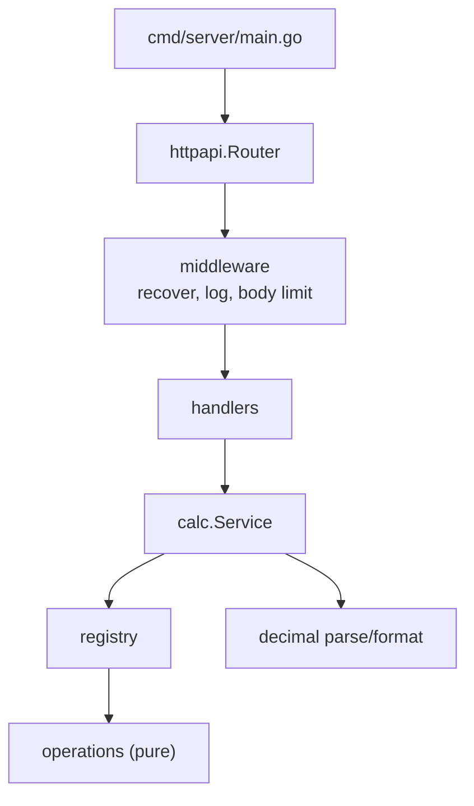

# 02. Backend design

Implements [01-api-spec.md](01-api-spec.md) · Language: Go 1.22+ (standard library only)

## 1. Principles

- **Pure core, thin edges.** All math lives in `internal/calc` with no HTTP knowledge. HTTP lives in `internal/httpapi` with no math.
- **Exact arithmetic** with `math/big.Rat` (standard library). No floats anywhere in the core.
- **Errors are values.** The core returns typed errors with a stable `Code`; the HTTP layer maps code to status.
- **Easy to extend.** A new operation is one function plus one registry entry.

## 2. Layout

```text
backend/
  cmd/server/main.go            # config, wiring, graceful shutdown
  internal/
    calc/
      errors.go                 # Error type, codes
      decimal.go                # Parse (strict) and Format (12 dp, trimmed)
      operations.go             # pure operation functions
      registry.go               # name -> {arity, fn}
      service.go                # Calculate(op, operands) -> result
      *_test.go
    httpapi/
      router.go                 # routes, method handling
      handlers.go               # calculate, operations, healthz
      errors.go                 # error envelope + status mapping
      middleware.go             # recovery, logging, body limit
      *_test.go
  go.mod
  Dockerfile
```



## 3. Core contracts (Go)

```go
// calc/errors.go
type Code string

type Error struct {
    Code    Code
    Message string
}
func (e *Error) Error() string { return e.Message }

// calc/service.go
type Service struct{ reg Registry }
func NewService() *Service
func (s *Service) Calculate(op string, operands []string) (string, error)
func (s *Service) Operations() []OperationInfo // name + arity, sorted

// calc/registry.go
type OperationFunc func(args []*big.Rat) (*big.Rat, error)
type Operation struct { Name string; Arity int; Fn OperationFunc }
```

`Calculate` flow: lookup operation (`UNKNOWN_OPERATION`), check arity (`INVALID_OPERAND_COUNT`), parse each
operand (`INVALID_OPERAND`), run the function, format the result (`OUT_OF_RANGE` if too large).

## 4. Numeric rules

| Topic | Rule |
|---|---|
| Parsing | Regex `^-?\d+(\.\d+)?$`, max 32 chars, then `big.Rat.SetString`. No exponent notation, no `+`, no spaces, no `1/3` |
| Formatting | `FloatString(12)` (rounds half away from zero), trim trailing zeros and trailing dot, normalize `-0` to `0` |
| Division | Exact rational, rounded only when formatting |
| Power | Integer exponent only. `abs(exponent) <= 100`. Negative exponent = reciprocal. `0^0 = 1`. `0^negative` is `DIVISION_BY_ZERO` |
| Square root | Compute `isqrt(n * 10^28 / d)` then scale, giving 14 digits; round to 12 on format. Negative input is `NEGATIVE_SQUARE_ROOT` |
| Percent | `[p, base]` returns `base * p / 100` |
| Range guard | If the result numerator or denominator exceeds 4096 bits, return `OUT_OF_RANGE` |

## 5. Edge case table (drives the tests)

| Operation | Input | Expected |
|---|---|---|
| add | `0.1 + 0.2` | `0.3` |
| add | `-5 + 5` | `0` |
| subtract | `0 - 0.1` | `-0.1` |
| multiply | `1.5 x 1.5` | `2.25` |
| multiply | `-0 x 5` | `0` (never `-0`) |
| divide | `10 / 4` | `2.5` |
| divide | `1 / 3` | `0.333333333333` |
| divide | `2 / 3` | `0.666666666667` |
| divide | `1 / 0` | error `DIVISION_BY_ZERO` |
| divide | `0 / 5` | `0` |
| power | `2 ^ 10` | `1024` |
| power | `2 ^ -2` | `0.25` |
| power | `0 ^ 0` | `1` |
| power | `0 ^ -1` | error `DIVISION_BY_ZERO` |
| power | `2 ^ 0.5` | error `NON_INTEGER_EXPONENT` |
| power | `2 ^ 101` | error `OUT_OF_RANGE` |
| sqrt | `sqrt(16)` | `4` |
| sqrt | `sqrt(2)` | `1.414213562373` |
| sqrt | `sqrt(0)` | `0` |
| sqrt | `sqrt(-1)` | error `NEGATIVE_SQUARE_ROOT` |
| percent | `15% of 200` | `30` |
| percent | `0% of 5` | `0` |
| any | operand `abc`, `1e3`, `""`, `1.`, `.5`, `+1` | error `INVALID_OPERAND` |
| any | operand longer than 32 chars | error `INVALID_OPERAND` |
| any | wrong operand count | error `INVALID_OPERAND_COUNT` |
| any | unknown operation | error `UNKNOWN_OPERATION` |

## 6. HTTP layer

- Go 1.22 pattern routing: `POST /api/v1/calculate`, `GET /api/v1/operations`, `GET /health`.
- Wrong method on a known path returns `405` with the JSON envelope and an `Allow` header.
- Request body: `http.MaxBytesReader` at 1 KB (`413 PAYLOAD_TOO_LARGE`), `json.Decoder.DisallowUnknownFields`, exactly one JSON value (`INVALID_JSON` otherwise).
- Status mapping: `INVALID_*` and `UNKNOWN_OPERATION` map to 400, domain errors map to 422.
- Unknown core errors map to `500 INTERNAL_ERROR` with a generic message; details go to the log only.
- Middleware order: recovery, request logging (method, path, status, duration), then the mux.
- Config: `PORT` (default `8080`). Graceful shutdown on SIGINT/SIGTERM with a 5 second timeout.
- No CORS headers: the frontend reaches the API through a proxy (see [00-overview](00-overview.md)).

## 7. Testing approach

- **Table-driven unit tests** in `calc` for every row of the edge case table above.
- **`httptest` handler tests** for each status code and the error envelope, using the real `calc.Service`.
- **Middleware tests**: panic returns 500 JSON, oversized body returns 413.
- Detailed targets and commands: [04-test-plan.md](04-test-plan.md).
