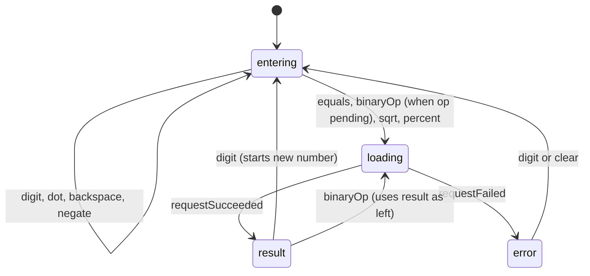

# 03. Frontend design

Consumes [01-api-spec.md](01-api-spec.md) · Stack: React 18 + TypeScript + Vite + Vitest

## 1. Principles

- **All math goes through the API.** The frontend never computes results; it only builds operands and displays results.
- **Pure state machine.** Calculator behavior lives in a pure reducer, so it is testable without React or network.
- **Strings everywhere.** Display values and operands are strings, matching the API (no float conversion).
- **Visual design** follows the taste skill (see [prompts/01](../../prompts/01-taste-design-brief.md)); this document covers structure and behavior only.

## 2. Layout

```text
frontend/
  src/
    api/
      client.ts               # calculate(), listOperations(), ApiError
      types.ts                # request/response/error types (mirror 01-api-spec)
    calculator/
      reducer.ts              # pure state machine
      types.ts                # State, Action, Operation keys
      format.ts               # display helpers (thousands, length limits)
    hooks/
      useCalculator.ts        # reducer + API side effects
      useKeyboard.ts          # keyboard to action mapping
    components/
      Header.tsx              # Sezzle wordmark (text only)
      Display.tsx             # expression + result, aria-live
      Keypad.tsx, Key.tsx
      History.tsx
      ErrorBanner.tsx
      Footer.tsx              # "Built by Valentina Varela Alzate" + links
    styles/tokens.css, app.css
    App.tsx, main.tsx
  vite.config.ts              # dev proxy: /api -> http://localhost:8080
  Dockerfile, nginx.conf
```

## 3. State machine

State:

```ts
type Status = 'entering' | 'result' | 'loading' | 'error'
interface State {
  display: string            // what the user sees, e.g. "12.5"
  left: string | null        // stored left operand
  op: BinaryOp | null        // pending operation
  status: Status
  error: { code: string; message: string } | null
  history: HistoryItem[]     // newest first, max 10
}
```

Actions: `digit`, `dot`, `backspace`, `clear`, `negate`, `binaryOp`, `equals`, `unaryOp(sqrt)`, `percent`,
`requestStarted`, `requestSucceeded`, `requestFailed`, `reuseHistory`.



Rules:

| Situation | Behavior |
|---|---|
| Max input length | 32 characters (matches API), extra digits ignored |
| Second decimal point | Ignored |
| Leading zeros | `0` then `5` shows `5` |
| Operator pressed twice | Replaces the pending operator |
| Chained `2 + 3 +` | Calls API for `2 + 3`, shows `5`, keeps `+` pending |
| `=` with no pending op | No-op |
| `%` with `+` or `-` pending | API `percent [display, left]`, result replaces display (like most calculators) |
| `%` otherwise | API `divide [display, "100"]` |
| `sqrt` | API `sqrt [display]` immediately |
| `^` | Binary operation `power` |
| API error | Show message, keep inputs so the user can correct; any digit or clear recovers |
| Buttons while `loading` | All disabled except `C` (Clear), which stays enabled: it cancels the in-flight request and resets the calculator, so the UI can never get stuck. Other keyboard input is ignored |

Error message mapping (friendly text, keyed by API `code`):

| Code | Message shown |
|---|---|
| `DIVISION_BY_ZERO` | Cannot divide by zero |
| `NEGATIVE_SQUARE_ROOT` | Square root needs a number of zero or more |
| `NON_INTEGER_EXPONENT` | The exponent must be a whole number |
| `OUT_OF_RANGE` | That number is too large to calculate |
| network failure | Cannot reach the calculator service. Try again |
| request timeout (10 s) | The calculator service took too long. Try again |
| anything else | Something went wrong. Try again |

## 4. API client

```ts
export class ApiError extends Error { code: string; status: number }
export async function calculate(operation: Operation, operands: string[], signal?: AbortSignal): Promise<string>
```

- Uses `fetch` against the relative path `/api/v1/calculate` (proxy handles host).
- Throws `ApiError` for non-2xx with the envelope; throws `NetworkError` when the request fails.
- Supports `AbortSignal`; a newer request cancels an older one.
- **Timeout:** every request is cancelled after **10 seconds**. The client throws a `RequestTimeoutError` (distinct from `NetworkError` and from a user abort, which still surfaces as `AbortError`). Implemented with an `AbortController` and `setTimeout` (cleared on completion) so it can be tested with fake timers.

## 5. Components

| Component | Responsibility | Key props |
|---|---|---|
| `Display` | Shows expression line and result, `role="status"` with `aria-live="polite"` | `expression`, `value`, `status` |
| `Keypad` | Grid of keys, wires clicks to actions | `onAction`, `disabled` |
| `Key` | Single button, variant (digit, operator, action, equals), visible focus | `label`, `ariaLabel`, `variant` |
| `History` | Last 10 operations, click to reuse a result | `items`, `onReuse` |
| `ErrorBanner` | Friendly error text, `role="alert"` | `error` |
| `Header` | "Sezzle" wordmark (text only, no logo artwork) | none |
| `Footer` | Author credit and links | none |

## 6. Keyboard map

| Key | Action |
|---|---|
| `0` to `9`, `.` | digit, dot |
| `+`, `-`, `*`, `/`, `^` | binary operation |
| `Enter`, `=` | equals |
| `Backspace` | backspace |
| `Escape`, `c` | clear |
| `%` | percent |
| `r` | square root |

## 7. Responsive and accessibility

- Mobile first, usable at 360px wide; keys have a minimum 44px touch target.
- Layout: single column on small screens, keypad and history side by side from tablet width.
- WCAG AA contrast, visible focus ring, every key has an accessible name (for example "Divide", "Square root").
- Respect `prefers-reduced-motion`.

## 8. Testing approach

- **Reducer unit tests** (the bulk): every row in the rules table.
- **API client tests** with a mocked `fetch`: success, each error code, network failure, abort.
- **Component tests** (Testing Library): click flow `2 + 3 =` shows `5`, error banner for division by zero, disabled keys while loading, keyboard input.
- Targets and commands: [04-test-plan.md](04-test-plan.md).
