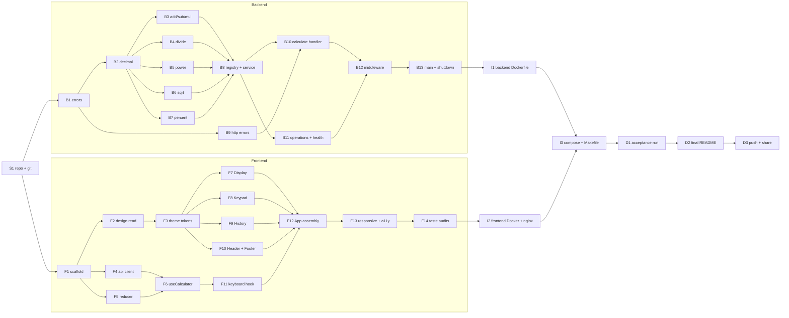

# 05. Implementation plan

Turns the specs (00 to 04) into **atomic tasks** that a person or an agent can take one by one, and that can run in parallel when their dependencies allow.

## 1. How to use this plan

**For the reviewer:** read the [task index](#3-task-index), take the next task whose dependencies are done, review the result against its **Done when** list, then tick it in the index.

**For an agent:** take exactly one task and follow this contract.

1. Read the task card and every doc under **Spec**. Do not read or edit code outside **Files**.
2. TDD: write the failing tests first, then the implementation (see [04-test-plan](04-test-plan.md)).
3. Run the **Verify** command. All of it must pass.
4. Do not edit the task index or other tasks. Report: what changed, Verify output, anything unexpected.
5. No em-dashes or en-dashes in code, comments or docs. Do not add dependencies that the task does not list.

**Task sizing:** each task is 10 to 25 minutes of work, touches few files, and has one clear result. Two tasks in different **lanes** never edit the same file, so they can run in parallel.

**Lanes:** `S` setup, `B` backend, `F` frontend, `I` infra, `D` docs.

## 2. Dependency graph

**Parallel waves** (everything inside a wave can run at the same time):

| Wave | Tasks |
|---|---|
| 0 | S1 |
| 1 | B1, F1 |
| 2 | B2, B9, F2, F4, F5 |
| 3 | B3, B4, B5, B6, B7, F3, F6 |
| 4 | B8, F7, F8, F9, F10, F11 |
| 5 | B10, B11, F12 |
| 6 | B12, F13 |
| 7 | B13, F14 |
| 8 | I1, I2 |
| 9 | I3, then D1, D2, D3 in order |

## 3. Task index

Tick a box only after reviewing the task against its **Done when** list.

| X | ID | Lane | Task | Depends on | Est. |
|---|---|---|---|---|---|
| [X] | S1 | S | Create repo, first docs commit | none | 5 min |
| [X] | B1 | B | Go module and error types | S1 | 10 min |
| [X] | B2 | B | Decimal parse and format | B1 | 20 min |
| [X] | B3 | B | Add, subtract, multiply | B2 | 10 min |
| [X] | B4 | B | Divide | B2 | 10 min |
| [X] | B5 | B | Power | B2 | 15 min |
| [X] | B6 | B | Square root | B2 | 20 min |
| [X] | B7 | B | Percent | B2 | 10 min |
| [X] | B8 | B | Registry and service | B3 to B7 | 15 min |
| [X] | B9 | B | HTTP error envelope and mapping | B1 | 15 min |
| [X] | B10 | B | `POST /api/v1/calculate` handler | B8, B9 | 20 min |
| [X] | B11 | B | Operations list and health handlers, 405 | B8 | 10 min |
| [X] | B12 | B | Middleware: recovery, logging, body limit | B10, B11 | 15 min |
| [X] | B13 | B | `main.go`, config, graceful shutdown | B12 | 10 min |
| [X] | F1 | F | Frontend scaffold and tooling | S1 | 15 min |
| [X] | F2 | F | Design read with taste skill (Step 1) | F1 | 10 min |
| [X] | F3 | F | Theme tokens and base styles | F2 | 15 min |
| [X] | F4 | F | API client and types | F1 | 15 min |
| [X] | F5 | F | Calculator reducer (pure) | F1 | 25 min |
| [X] | F6 | F | `useCalculator` hook | F4, F5 | 15 min |
| [X] | F7 | F | Display component | F3 | 10 min |
| [X] | F8 | F | Keypad and Key components | F3 | 15 min |
| [X] | F9 | F | History component | F3 | 10 min |
| [X] | F10 | F | Header (wordmark) and Footer (credit) | F3 | 10 min |
| [ ] | F11 | F | `useKeyboard` hook | F6 | 10 min |
| [ ] | F12 | F | App assembly with error and loading states | F7 to F11 | 15 min |
| [ ] | F13 | F | Responsive and accessibility pass | F12 | 15 min |
| [ ] | F14 | F | Taste audits (Step 3) and fixes | F13 | 15 min |
| [ ] | F15 | F | Client request timeout (10 s) | F4, F6 | 15 min |
| [ ] | F16 | F | Keep Clear enabled while loading | F8 | 5 min |
| [X] | I1 | I | Backend Dockerfile | B13 | 10 min |
| [ ] | I2 | I | Frontend Dockerfile and nginx proxy | F14 | 10 min |
| [ ] | I3 | I | Compose and root Makefile | I1, I2 | 10 min |
| [ ] | D1 | D | Acceptance run (A1 to A8) and coverage | I3 | 15 min |
| [ ] | D2 | D | Final README (setup, API, decisions, coverage, prompts) | D1 | 15 min |
| [ ] | D3 | D | Push and share the repository link | D2 | 5 min |

Total effort is above the 2 to 4 hour brief when done serially; running the two lanes in parallel with agents
fits the time box. Cut order if time is short: B6, B5, then F9 (history) and F11 (keyboard), in that order.

## 4. Task cards

### S. Setup

#### S1. Create repo, first docs commit
- **Spec:** [00-overview](00-overview.md)
- **Files:** `.git/` (new)
- **Steps:** `git init -b main`, check `.gitignore`, first commit `docs: add SDD specs, README and prompts`.
- **Done when:** repo has one clean commit; `git status` is clean; `.agents/` and `skills-lock.json` are ignored.
- **Verify:** `git log --oneline` shows one commit and `git status --short` is empty.

### B. Backend (all paths under `backend/`)

#### B1. Go module and error types
- **Spec:** [02](02-backend-design.md) sections 2, 3
- **Files:** `go.mod` (module `github.com/Valentina17varela/sezzle-calculator/backend`), `internal/calc/errors.go`, `internal/calc/errors_test.go`
- **Done when:** `Code` constants for every code in [01 section 5](01-api-spec.md); `Error` implements `error`; constructor helper `newError(code, msg)`.
- **Verify:** `cd backend && go vet ./... && go test ./internal/calc/...`

#### B2. Decimal parse and format
- **Spec:** [02 section 4](02-backend-design.md)
- **Files:** `internal/calc/decimal.go`, `internal/calc/decimal_test.go`
- **Done when:** `ParseDecimal(string) (*big.Rat, error)` accepts only `^-?\d+(\.\d+)?$` up to 32 chars; `FormatDecimal(*big.Rat) (string, error)` gives 12 dp, trimmed, no `-0`, `OUT_OF_RANGE` above 4096 bits. Tests cover: `0.1`, `-5`, `007`, `abc`, `1e3`, `""`, `1.`, `.5`, `+1`, 33 chars, rounding half away from zero, `-0`.
- **Verify:** `go test ./internal/calc/... -run Decimal`

#### B3. Add, subtract, multiply
- **Spec:** [02 section 5](02-backend-design.md)
- **Files:** `internal/calc/operations.go`, `internal/calc/operations_arith_test.go`
- **Done when:** `Add`, `Subtract`, `Multiply` as `OperationFunc`; table tests from the edge case table pass (`0.1+0.2`, `-5+5`, `0-0.1`, `1.5x1.5`, `-0x5`).
- **Verify:** `go test ./internal/calc/... -run Arith`

#### B4. Divide
- **Files:** `internal/calc/operations.go` (append), `internal/calc/operations_divide_test.go`
- **Done when:** `Divide` returns `DIVISION_BY_ZERO` for zero divisor; `10/4`, `1/3`, `2/3`, `0/5` tests pass.
- **Verify:** `go test ./internal/calc/... -run Divide`

#### B5. Power
- **Files:** `internal/calc/operations.go` (append), `internal/calc/operations_power_test.go`
- **Done when:** integer exponent only (`NON_INTEGER_EXPONENT`), `abs(exp) <= 100` else `OUT_OF_RANGE`, negative exponent is reciprocal, `0^0 = 1`, `0^-1` is `DIVISION_BY_ZERO`; all power rows in the edge table pass.
- **Verify:** `go test ./internal/calc/... -run Power`

#### B6. Square root
- **Files:** `internal/calc/operations.go` (append), `internal/calc/operations_sqrt_test.go`
- **Done when:** integer square root on scaled value gives 14 digits; `sqrt(16)=4`, `sqrt(2)=1.414213562373`, `sqrt(0)=0`, negative returns `NEGATIVE_SQUARE_ROOT`; also a perfect square with decimals (`sqrt(2.25)=1.5`).
- **Verify:** `go test ./internal/calc/... -run Sqrt`

#### B7. Percent
- **Files:** `internal/calc/operations.go` (append), `internal/calc/operations_percent_test.go`
- **Done when:** `Percent([p, base]) = base * p / 100`; `15% of 200 = 30`, `0% of 5 = 0`, negative and decimal cases.
- **Verify:** `go test ./internal/calc/... -run Percent`

#### B8. Registry and service
- **Spec:** [02 section 3](02-backend-design.md)
- **Files:** `internal/calc/registry.go`, `internal/calc/service.go`, `internal/calc/service_test.go`
- **Done when:** `NewService()`, `Calculate`, `Operations()` (sorted by name) work; unknown operation, wrong arity and invalid operand return the right codes; end to end table test for all 7 operations through `Calculate`.
- **Verify:** `go test ./internal/calc/... -cover` (at least 95%)

#### B9. HTTP error envelope and mapping
- **Spec:** [01 section 5](01-api-spec.md), [02 section 6](02-backend-design.md)
- **Files:** `internal/httpapi/errors.go`, `internal/httpapi/errors_test.go`
- **Done when:** `writeError(w, status, code, msg)` writes `{"error":{"code","message"}}`; `statusFor(code)` maps 400, 422, 405, 413, 500 per the spec; unknown errors become `INTERNAL_ERROR` without leaking details.
- **Verify:** `go test ./internal/httpapi/... -run Error`

#### B10. `POST /api/v1/calculate` handler
- **Files:** `internal/httpapi/handlers.go`, `internal/httpapi/router.go`, `internal/httpapi/calculate_test.go`
- **Done when:** decodes with `DisallowUnknownFields`, exactly one JSON value; returns the response from [01 section 4](01-api-spec.md); `httptest` cases for 200 (each operation), 400 (`INVALID_JSON`, `UNKNOWN_OPERATION`, `INVALID_OPERAND_COUNT`, `INVALID_OPERAND`), 422 (each domain error).
- **Verify:** `go test ./internal/httpapi/... -run Calculate`

#### B11. Operations list and health handlers, 405
- **Files:** `internal/httpapi/handlers.go` (append), `internal/httpapi/router.go`, `internal/httpapi/misc_test.go`
- **Done when:** `GET /api/v1/operations` returns the list; `GET /health` returns `{"status":"ok"}`; wrong method returns 405 envelope with `Allow` header.
- **Verify:** `go test ./internal/httpapi/... -run "Operations|Health|Method"`

#### B12. Middleware
- **Files:** `internal/httpapi/middleware.go`, `internal/httpapi/middleware_test.go`, `internal/httpapi/router.go`
- **Done when:** panic in a handler returns 500 JSON and the server keeps running; request log line has method, path, status, duration; body over 1 KB returns 413 `PAYLOAD_TOO_LARGE`.
- **Verify:** `go test ./internal/httpapi/... -race -cover` (at least 90%)

#### B13. `main.go`, config, graceful shutdown
- **Files:** `cmd/server/main.go`
- **Done when:** reads `PORT` (default 8080); handles SIGINT/SIGTERM with a 5 second graceful shutdown; sets `ReadHeaderTimeout`.
- **Verify:** `go build ./... && PORT=8081 go run ./cmd/server` then `curl -s localhost:8081/health` and the three `curl` examples from [01 section 6](01-api-spec.md).

### F. Frontend (all paths under `frontend/`)

#### F1. Frontend scaffold and tooling
- **Spec:** [03 section 2](03-frontend-design.md)
- **Files:** Vite React TS template, `vite.config.ts` (proxy `/api` to `http://localhost:8080`), Vitest, Testing Library, `@vitest/coverage-v8` (HTML reporter writing to `../docs/coverage/frontend`), ESLint, npm scripts `dev`, `build`, `test`, `test:coverage`, `lint`.
- **Done when:** empty app builds; one smoke test passes.
- **Verify:** `cd frontend && npm run lint && npm run test -- --run && npm run build`

#### F2. Design read with taste skill (Step 1 of the prompt)
- **Spec:** [prompts/01](../../prompts/01-taste-design-brief.md), skill in `.agents/skills/design-taste-frontend/`
- **Files:** `docs/design-read.md`
- **Done when:** one-sentence design read and the three dial values with one-line reasoning each; exact Sezzle-inspired palette hex values confirmed from sezzle.com; **you approve it before F3** (human gate).
- **Verify:** you read and say OK.

#### F3. Theme tokens and base styles
- **Spec:** `docs/design-read.md`
- **Files:** `src/styles/tokens.css`, `src/styles/app.css`
- **Done when:** CSS variables for color, type scale, spacing, radius, focus ring; light theme only; `prefers-reduced-motion` respected; no em-dashes.
- **Verify:** `npm run build`

#### F4. API client and types
- **Spec:** [03 section 4](03-frontend-design.md), [01](01-api-spec.md)
- **Files:** `src/api/types.ts`, `src/api/client.ts`, `src/api/client.test.ts`
- **Done when:** `calculate()` returns the result string; `ApiError` carries `code` and `status`; network failure throws `NetworkError`; abort supported; tests with mocked `fetch` for success, each error code, network failure, abort.
- **Verify:** `npm run test -- --run src/api`

#### F5. Calculator reducer (pure)
- **Spec:** [03 section 3](03-frontend-design.md)
- **Files:** `src/calculator/types.ts`, `src/calculator/reducer.ts`, `src/calculator/format.ts`, `src/calculator/reducer.test.ts`
- **Done when:** one test per row of the rules table (max length, second dot, leading zero, operator replace, chaining, `=` with no op, `%` both modes, sqrt, error recovery, loading ignores input, history capped at 10).
- **Verify:** `npm run test -- --run src/calculator` (coverage of reducer at least 95%)

#### F6. `useCalculator` hook
- **Files:** `src/hooks/useCalculator.ts`, `src/hooks/useCalculator.test.ts`
- **Done when:** dispatches actions, triggers the API call on `equals`, chained operator, `sqrt`, `%`; maps `ApiError` codes to friendly messages; cancels the previous request when a new one starts. Tests with a mocked client.
- **Verify:** `npm run test -- --run src/hooks/useCalculator`

#### F7. Display component
- **Files:** `src/components/Display.tsx`, `Display.test.tsx`
- **Done when:** shows expression and value, `role="status"` with `aria-live="polite"`, long values do not overflow.
- **Verify:** `npm run test -- --run Display`

#### F8. Keypad and Key components
- **Files:** `src/components/Keypad.tsx`, `Key.tsx`, tests
- **Done when:** all keys from [03 section 6](03-frontend-design.md) present with accessible names; variants styled by tokens; disabled state while loading; 44px minimum target.
- **Verify:** `npm run test -- --run Keypad`

#### F9. History component
- **Files:** `src/components/History.tsx`, test
- **Done when:** lists the last 10 operations, clicking an item reuses its result; empty state text.
- **Verify:** `npm run test -- --run History`

#### F10. Header and Footer
- **Files:** `src/components/Header.tsx`, `Footer.tsx`, tests
- **Done when:** header shows the "Sezzle" text wordmark; footer shows "Built by Valentina Varela Alzate" with GitHub and LinkedIn links that open safely (`rel="noopener noreferrer"`).
- **Verify:** `npm run test -- --run "Header|Footer"`

#### F11. `useKeyboard` hook
- **Files:** `src/hooks/useKeyboard.ts`, test
- **Done when:** key map from [03 section 6](03-frontend-design.md); ignored while `loading` and while typing in an input; listener cleaned up on unmount.
- **Verify:** `npm run test -- --run useKeyboard`

#### F12. App assembly with error and loading states
- **Files:** `src/App.tsx`, `src/main.tsx`, `src/components/ErrorBanner.tsx`, `src/App.test.tsx`
- **Done when:** component test `2 + 3 =` shows `5` (mocked API); `1 / 0 =` shows the friendly error with `role="alert"`; keys disabled while loading.
- **Verify:** `npm run test -- --run && npm run build`

#### F13. Responsive and accessibility pass
- **Files:** `src/styles/*`, component files as needed
- **Done when:** no horizontal scroll at 360px; keys at least 44px; contrast AA; focus order is logical; full keyboard use works. Checked with the browser preview at 360, 768 and 1280.
- **Verify:** manual checklist recorded in `docs/design-read.md` under "Audits".

#### F14. Taste audits (Step 3 of the prompt)
- **Spec:** [prompts/01](../../prompts/01-taste-design-brief.md)
- **Files:** `docs/design-read.md` (audit results), fixes in `src/`
- **Done when:** em-dash audit has zero hits across the repo (`grep -rnP "\x{2014}|\x{2013}" . --exclude-dir=node_modules --exclude-dir=.git`), Pre-Flight Check items all Pass, accessibility and mobile audits pass. Any Fail blocks completion.
- **Verify:** audit section in `docs/design-read.md` is complete and the grep returns nothing.

#### F15. Client request timeout (10 s)
- **Spec:** [03 section 4](03-frontend-design.md) (Timeout) and the error table in section 3
- **Files:** `src/api/client.ts`, `src/api/client.test.ts`, `src/hooks/useCalculator.ts`, `src/hooks/useCalculator.test.ts`
- **Done when:** `calculate()` and `listOperations()` abort after 10 s using an `AbortController` plus `setTimeout` (cleared in `finally`); a timeout throws `RequestTimeoutError`, a caller abort still throws `AbortError`; `messageForError` maps `RequestTimeoutError` to "The calculator service took too long. Try again" and the error code is `TIMEOUT`. Tests with `vi.useFakeTimers`: timeout fires at 10 s and not before, timer cleared on success, caller abort is not reported as timeout, hook shows the timeout message and recovers.
- **Verify:** `npm run test -- --run src/api src/hooks && npm run lint && npm run build`

#### F16. Keep Clear enabled while loading
- **Spec:** [03 section 3](03-frontend-design.md) (Buttons while loading)
- **Files:** `src/components/Keypad.tsx`, `src/components/Keypad.test.tsx`
- **Done when:** with `disabled` true every key is disabled **except Clear**; pressing Clear while loading dispatches `clear`. Test: all other keys disabled, Clear enabled and dispatches. Depends on the reducer already accepting `clear` during loading (it does and cancels the request through the hook cleanup).
- **Verify:** `npm run test -- --run Keypad && npm run lint`

### I. Infrastructure

#### I1. Backend Dockerfile
- **Files:** `backend/Dockerfile`, `backend/.dockerignore`
- **Done when:** multi-stage build, static binary, non-root user, small final image.
- **Verify:** `docker build -t sezzle-calc-api backend && docker run --rm -p 8080:8080 sezzle-calc-api` then `curl localhost:8080/health`.
- **Also delivered with I1 (reviewed):** `backend/scripts/smoke.sh` (26 API checks, exits non-zero on any failure, used again in D1 against `docker compose up`) and native Go fuzz tests in `internal/calc/fuzz_test.go` (`go test ./internal/calc -run '^$' -fuzz FuzzCalculate -fuzztime 30s`).

#### I2. Frontend Dockerfile and nginx proxy
- **Files:** `frontend/Dockerfile`, `frontend/nginx.conf`, `frontend/.dockerignore`
- **Done when:** builds static assets, nginx serves them and proxies `/api/` to the `api` service.
- **Verify:** `docker build -t sezzle-calc-web frontend`

#### I3. Compose and root Makefile
- **Files:** `docker-compose.yml`, `Makefile`
- **Done when:** `docker compose up --build` serves the app at `http://localhost:8080` (web) with the API reachable only through the proxy; Makefile targets `dev`, `test`, `coverage`, `lint`, `up`, `down`.
- **Verify:** `docker compose up --build -d` then scenario A8 from [04](04-test-plan.md).

### D. Documentation and delivery

#### D1. Acceptance run and coverage
- **Spec:** [04](04-test-plan.md)
- **Done when:** scenarios A1 to A8 pass and are recorded (table with Pass/Fail); backend coverage at least 90%, frontend at least 85%.
- **Verify:** `make coverage` regenerates `docs/coverage/backend.html` and `docs/coverage/frontend/index.html` (committed, overwritten each run); the summary is pasted into the README in D2.

#### D2. Final README
- **Spec:** [00 section 6](00-overview.md) (HR checklist)
- **Files:** `README.md`
- **Done when:** setup, how to run frontend and backend, Docker, API examples (copy from [01](01-api-spec.md)), design decisions and assumptions, coverage table, prompts table complete, status badges updated to Done, screenshots of the UI (desktop and 360px).
- **Verify:** a fresh clone follows the README and works without extra steps.

#### D3. Push and share
- **Done when:** repo pushed, HR checklist in [00](00-overview.md) fully ticked, link sent to Sezzle within the deadline.

## 5. Recommended agent split (optional)

| Agent | Takes | Notes |
|---|---|---|
| A (backend core) | B1, B2, then B3 to B7 | B3 to B7 are independent; can be split among agents |
| B (backend HTTP) | B9, then B10 to B13 after B8 | Waits for B8 |
| C (frontend logic) | F1, F4, F5, F6, F11 | Pure logic, no design dependency |
| D (frontend UI) | F2 (needs your OK), F3, F7 to F10, F12 to F14 | Uses the taste skill |
| E (infra and docs) | I1 to I3, D1 to D3 | Starts when the lanes finish |

Merge order to avoid conflicts: backend lane and frontend lane touch different folders, so they merge independently; shared files
(`README.md`, `Makefile`, `docker-compose.yml`) are edited only by agent E.
