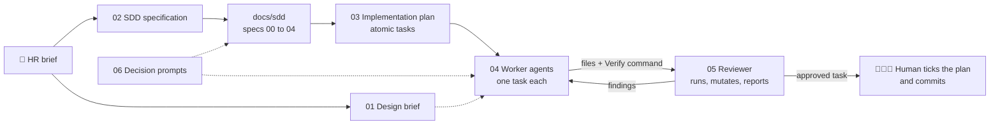

# 🤖 Prompts

The project follows **Spec-Driven Development (SDD)**: specs first, then tests, then code. One person directed the work and made every decision. Claude (through Claude Code) played three roles, plus a design skill for the UI:

| Role | What it did | Prompt |
|---|---|---|
| **Architect** | Turned the HR brief into specs, an ADR log and an atomic task plan | [02](02-sdd-specification.md), [03](03-implementation-plan.md) |
| **Worker agents** | Implemented one task at a time (backend, frontend, infra), tests first | [04](04-worker-agents.md) |
| **Reviewer and executor** | Ran what the workers could not (builds, servers, Docker), challenged the tests, reported findings | [05](05-reviewer.md) |
| **Design skill** | A loaded design-taste skill was the only source of UI rules | [01](01-taste-design-brief.md) |

## Index

| # | Prompt | Phase | What it produced |
|---|---|---|---|
| 01 | [Design brief (taste skill)](01-taste-design-brief.md) | Design | Brief, three design dials, audits for the UI |
| 02 | [SDD specification](02-sdd-specification.md) | Specs | `docs/sdd/00` to `04`, the ADR log and the living README |
| 03 | [Implementation plan](03-implementation-plan.md) | Planning | `docs/sdd/05`: atomic, parallelizable, reviewable tasks |
| 04 | [Worker agents](04-worker-agents.md) | Build | The task contract and the assignment messages |
| 05 | [Reviewer and executor](05-reviewer.md) | Review | The review protocol, checklists and report format |
| 06 | [Decision prompts](06-decision-prompts.md) | Throughout | Short directives that settled design and scope questions |

## Constants across all prompts

- **Specs before code.** No implementation without a written contract and a table of edge cases.
- **Tests first.** Expected values come from the spec, never from the code under test.
- **Small tasks.** One task, a short list of files, one result, one Verify command.
- **No invented facts.** URLs, versions, colors and numbers come from a source (the CV, the live site, the spec). If unknown, the answer is "unknown".
- **A human gate.** Only the author ticks the plan, approves designs and commits.
- **Free and open assets only.** Fonts under OFL, icons under MIT or ISC, text wordmark instead of any logo.
- **No em-dashes or en-dashes** in code, comments or docs (audited with a grep).
